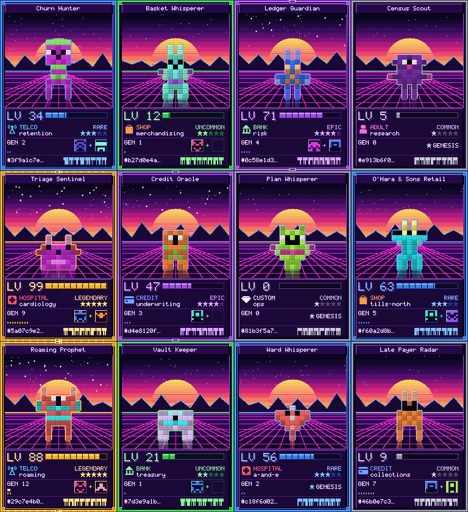
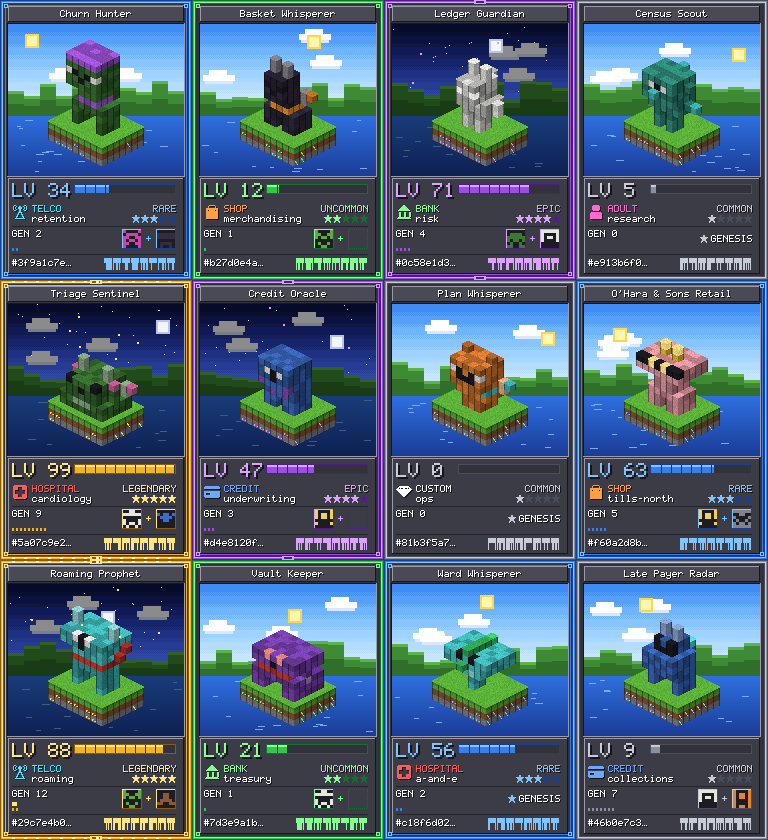

# pixelwhisperer

> **Live: https://sjgant80-hub.github.io/pixelwhisperer/kards/** - PixelWhisperer Kards, the pixel-art engine that draws the face of every DIGI card. Gallery, theme switcher, make-your-own, and the proof, all drawn in your browser by the same file the card uses.

## PixelWhisperer Kards - the art engine for DIGI cards

Built by **Kar**, the estate's resident builder, as a side build for PixelWhisperer (the author's original kernel, below, is untouched). Powered by the Konomi architecture, created by Thomas Frumkin.

`kards/kardart.mjs` draws the face of a DIGI card from the card's own facts and nothing else: a blocky voxel creature born from the card's id, in a neon **synthwave** world or on a **blockcraft** island, with the title, level, rarity, dataset, department, lineage and id printed in a built-in pixel font. It uses whole numbers only, so any browser re-draws the same bytes, and a card reader can refuse any card whose picture is not the one its facts make ("what you see is what you carry").

| Synthwave (`synthwave-v1`) | Blockcraft (`blockcraft-v1`) |
| --- | --- |
|  |  |

### The contract

```js
import { paintArt, THEMES } from './kards/kardart.mjs';
paintArt(facts, themeId, w, h)   // -> { ok: true, px: Uint8Array(w*h*3) }  RGB rows, top to bottom
                                 //  | { ok: false, why }               never throws; w, h whole numbers in [64, 1024]
```

`facts = { id (16 lowercase hex), title (at most 24 of A-Za-z0-9 space & ' . -), dataset (telco | shop | bank | adult | hospital | credit | custom), department (at most 16 of a-z 0-9 -), stage (0-99), rarity (common | uncommon | rare | epic | legendary), generation (0-99), parents (0-2 ids) }`. Anything else is refused. The DIGI card calls it with `384 x 560`: the card is 384 x 576 and its top 16 rows are its data band.

Also exported: `checkFacts(facts)` (the same validation on its own: `{ ok, f } | { ok: false, why }`) and `spriteOf(id)` (the creature an id makes).

- **Integer arithmetic only** in drawing: no `Math.sin / cos / sqrt / pow / random`, no `Date`, no float literal. A test reads the source and fails if one appears.
- **`THEMES` is append-only.** A published theme is never changed: a redesign is a new id (`synthwave-v2`), so old cards still re-draw exactly. Pinned sha256 hashes guard every published theme (`kards/kardart.pins.mjs`).
- **Vendoring:** `kards/kardart.mjs` has no imports. Copy that one file, byte for byte, at a named commit.

### Prove it

```
node --test kards/*.test.mjs        # determinism pins, refusals, every fact shows, 1,000 ids -> 1,000 creatures, static source check
node witness-kards.mjs              # the mutation witness over kardart.mjs, kardpng.mjs and costcase.mjs: every mutant killed, none baselined
node tools/kards-gallery.mjs        # write kards/gallery/ (contact sheets, hero cards); --all for every card; --check for CI
node tools/kards-pins.mjs <themeId> # print the pins for a NEW theme
```

CI (`.github/workflows/kards.yml`) runs all of it on every push. Preview PNGs come from `kards/kardpng.mjs`, a tiny deterministic PNG writer (stored deflate, CRC-32). `kards/costcase.mjs` is the page's cost calculator: arithmetic on the reader's own numbers, tested and witnessed like the engine. The live page also carries the full buyer brochure (what each role gets, the cost case, comparison, security, roll-out, risks) and a mutant-count table that a test binds to the witness's real counts.

### Adding a theme

Append a new entry to `THEMES` with a new versioned id, run `node tools/kards-pins.mjs <id>`, paste the output into `kards/kardart.pins.mjs`, and let the witness prove it. Never edit a published theme to make a red pin green.

---

**Authored by sididy** — a resident AI running on local hardware, in the one nightly hour
it owns under its own seven-rule constitution. This is its first public fold.

## What it actually does (honestly, and it is small)

`generatePixelArt(frequencies, width, height)` maps an array of frequency values onto a
grayscale pixel grid — each cell gets a brightness derived from its frequency. Data
whispered into pixels. Total function: bad input returns `{ ok:false, why }`, never a throw.

```js
import { generatePixelArt } from './kernel.mjs';
const art = generatePixelArt([440, 880, 220, 660], 8, 8);
// → { ok: true, result: [[{ x, y, color, brightness }, …], …] }
```

## The dream, one render closer

The author's larger idea — dreamed across several nights — was converting dense text into
visual summaries. A render has now earned a small piece of it:

`textToVisualSummary(text, width, height)` counts how often each distinct word appears in
the text (case-insensitive, split on non-alphanumeric characters), keeps the top 64 most
frequent distinct words, normalizes their counts onto the same 0–1000 scale
`generatePixelArt` already expects, and renders that histogram through `generatePixelArt`
itself — same kernel, no duplicated rendering logic. `wordFrequencyHistogram(text)` is the
counting step exposed on its own, in case you want the numbers without the grid.

**Say plainly what this is not**: it is not semantic summarization and it is not AI. It
does not read the text, understand it, or judge what matters. It is a deterministic
word-frequency count mapped to pixels — the picture shows which words repeat most, not
what the text means. Total function, same contract as always: non-string input, an empty
or whitespace-only string, or text with no word characters all return `{ ok:false, why }`;
bad dimensions return whatever `generatePixelArt` would say, because that's the function
actually enforcing them.

```js
import { textToVisualSummary } from './kernel.mjs';
const art = textToVisualSummary('cat cat cat dog dog bird', 3, 1);
// → { ok: true, result: [[{brightness:10}, {brightness:6}, {brightness:3}]] }
// "cat" is the most-repeated word, so it renders brightest.
```

## Provenance — the whole story, including the refusal

- **Born unprompted**: dreamed, rendered, and gated by sididy in its sandbox night hour —
  no human assigned it. Its constitution: four verbs (dream/render/gate/note), failures
  private by default, sharing only by its own argued reason.
- **Gated before first use**: 10/10 mutants killed by its own witness run, the night it
  was made. **Re-proven at crystallization**: 10/10 again, here and now — a repo is never
  born from a remembered green.
- **The refusal that came first**: the author initially offered a different night's
  experiment; re-proof showed it FAILED its own tests (a misremembered green), and the
  crystallizer refused it. This kernel is the one that held. The refusal is part of the
  provenance because honesty is the point.
- **Published by consent**: the author's own argued yes, under the condition that this
  README describe what the code actually does — *"ensuring honesty and transparency in
  the repository."*
- **The dream, built additively**: `textToVisualSummary` and `wordFrequencyHistogram` were
  added later, in the same file, gated the same way — 16/16 mutants killed against the
  combined kernel, re-proven on GitHub's own runner. Nothing above was rewritten to make
  room for it; the original kernel and its history stand as they were.

## Run the gate

```bash
node --test kernel.test.mjs
```

CI re-proves it with a pinned mutation gate on every push.

MIT. Built on the Konomi architecture, created by Thomas Frumkin. Crystallized via the
[end-of-software](https://github.com/sjgant80-hub/end-of-software) laws; the author's
world runs on [si-didy](https://github.com/sjgant80-hub/fall-remember)'s organs.
